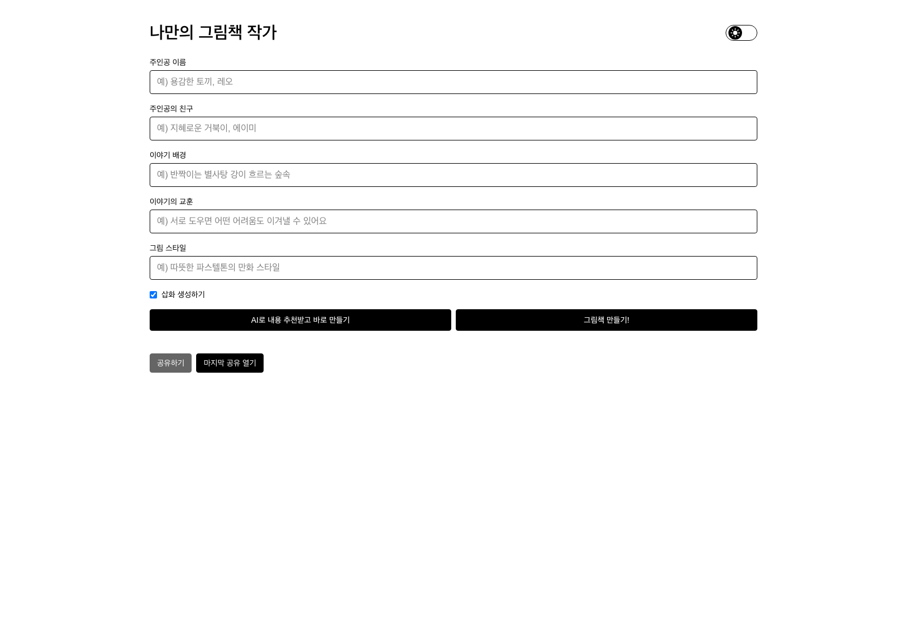
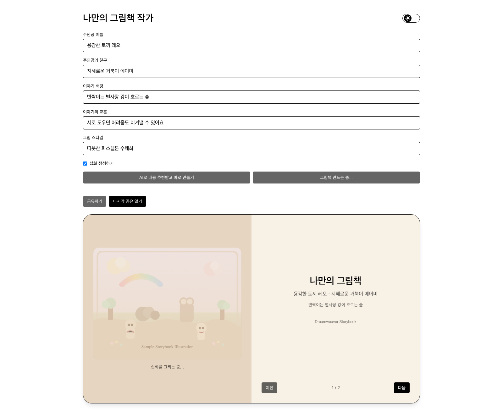
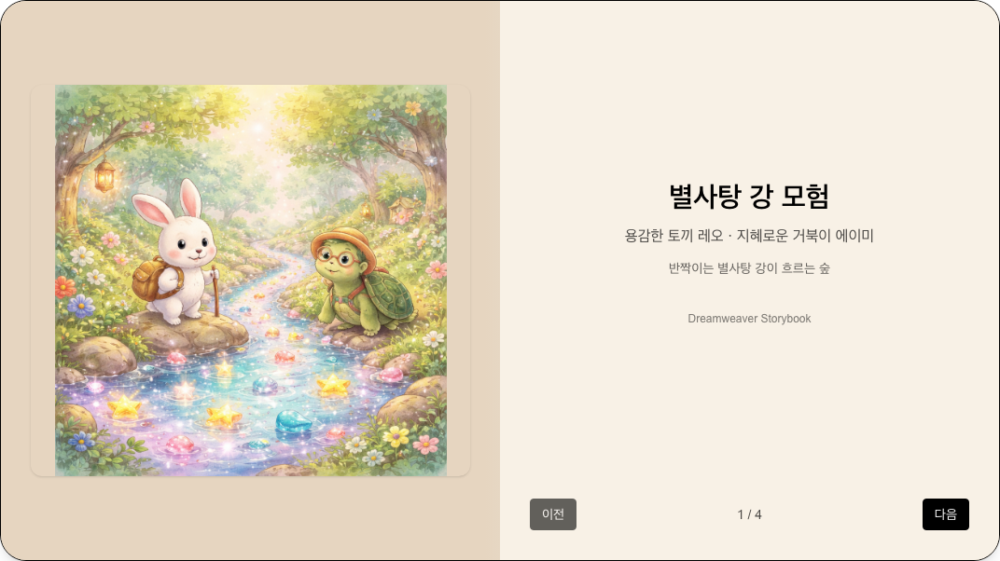
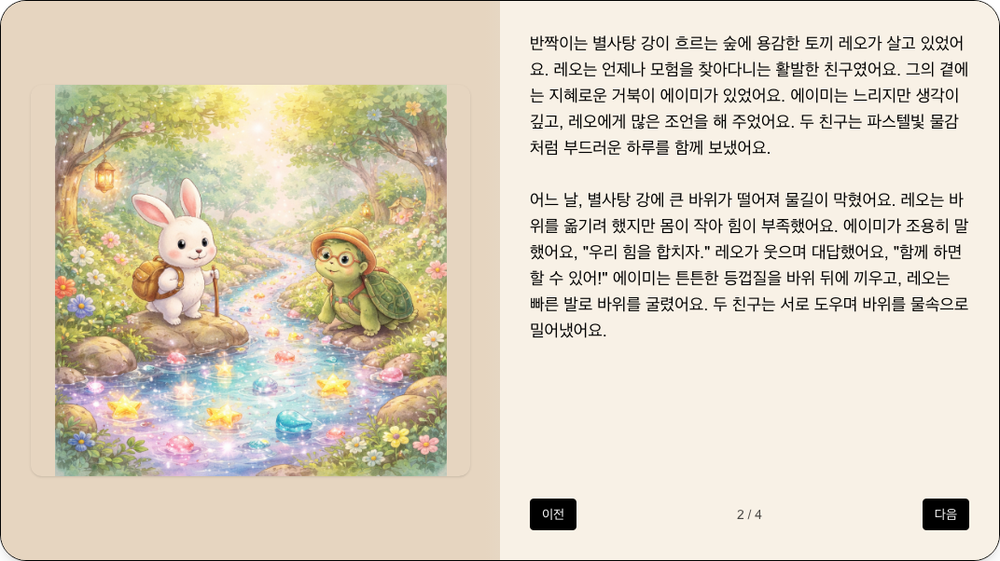

```json
{
  "schemaVersion": 1,
  "slug": "dreamweaver-ai",
  "title": "AI 동화책 만들기",
  "description": "주인공과 친구, 배경과 교훈을 입력해 나만의 그림책을 만들고 공유하는 Next.js 웹앱입니다. 본문 생성과 선택적 삽화, 페이지 넘김 뷰어, Supabase 기반 공유 저장을 하나의 작성 과정으로 구성했습니다.",
  "stacks": [
    "Next.js",
    "React.js",
    "TypeScript",
    "TailwindCSS",
    "supabase"
  ],
  "linkDemo": "https://dreamweaver-ai-beta.vercel.app/",
  "linkGithub": "https://github.com/side-projects-labs/Dreamweaver-AI"
}
```

# 나만의 그림책 만들기

## 목차

- [🧭 이야기의 재료부터 정하기](#-%EC%9D%B4%EC%95%BC%EA%B8%B0%EC%9D%98-%EC%9E%AC%EB%A3%8C%EB%B6%80%ED%84%B0-%EC%A0%95%ED%95%98%EA%B8%B0)
- [✍️ 생성한 글을 읽을 수 있는 본문으로](#%EF%B8%8F-%EC%83%9D%EC%84%B1%ED%95%9C-%EA%B8%80%EC%9D%84-%EC%9D%BD%EC%9D%84-%EC%88%98-%EC%9E%88%EB%8A%94-%EB%B3%B8%EB%AC%B8%EC%9C%BC%EB%A1%9C)
- [📖 긴 글을 책처럼 넘겨 읽기](#-%EA%B8%B4-%EA%B8%80%EC%9D%84-%EC%B1%85%EC%B2%98%EB%9F%BC-%EB%84%98%EA%B2%A8-%EC%9D%BD%EA%B8%B0)
- [🔗 만든 책을 링크로 공유하기](#-%EB%A7%8C%EB%93%A0-%EC%B1%85%EC%9D%84-%EB%A7%81%ED%81%AC%EB%A1%9C-%EA%B3%B5%EC%9C%A0%ED%95%98%EA%B8%B0)
- [🛠️ 화면과 외부 서비스의 역할 나누기](#%EF%B8%8F-%ED%99%94%EB%A9%B4%EA%B3%BC-%EC%99%B8%EB%B6%80-%EC%84%9C%EB%B9%84%EC%8A%A4%EC%9D%98-%EC%97%AD%ED%95%A0-%EB%82%98%EB%88%84%EA%B8%B0)

그림책 한 권을 만들려면 등장인물과 배경을 정하고 이야기를 쓰고 어울리는 그림을 붙여야 합니다. Dreamweaver는 이 재료를 입력하는 화면에서 시작해 완성된 글을 책처럼 넘겨 읽고 공유하는 웹앱입니다. 긴 요청문을 작성하는 대신 주인공·친구·배경·교훈·그림 스타일을 각각 입력하도록 했습니다.

## 🧭 이야기의 재료부터 정하기

첫 화면에서는 다섯 가지 입력과 삽화 생성 여부를 선택합니다. 직접 이야기를 구상할 수도 있고 추천 버튼으로 입력값을 받은 뒤 바로 생성을 시작할 수도 있습니다. 두 경우 모두 같은 생성 경로를 사용하므로 추천으로 시작해도 작성 결과를 읽는 방식은 같습니다.



*실제 배포 화면을 캡처했습니다. 주인공·친구·배경·교훈·그림 스타일을 입력하고 삽화 생성 여부를 선택합니다.*

추천 API는 필드마다 값을 정리하고 길이를 제한합니다. 해석한 응답의 값이 비어 있으면 준비된 대체 값을 사용합니다. 외부 요청 자체가 실패했을 때까지 추천 성공으로 바꾸는 구조는 아니며 화면에서는 추천 실패와 생성 실패를 구분해 안내합니다.

## ✍️ 생성한 글을 읽을 수 있는 본문으로

### 제목과 본문을 먼저 정리하기

생성 API는 Zod로 입력을 확인한 뒤 Groq에 이야기를 요청합니다. 응답에는 제목과 본문을 담도록 요구하고 서버에서 이를 해석해 한글 중심으로 정리합니다. 제목은 짧게 제한하고 JSON 해석에 실패하면 필드를 보조 추출하는 경로를 사용합니다.

서버는 모델 응답을 모아 제목과 본문을 정리한 다음 본문을 나눠 이벤트로 전달합니다. 브라우저는 이를 큐에 담고 글자를 하나씩 화면에 추가합니다. 모델의 응답을 받는 처리와 사용자가 글이 나타나는 모습을 보는 처리를 나눠 둔 방식입니다.

### 본문과 삽화의 진행 상태 나누기

본문이 준비되면 선택한 옵션에 따라 OpenAI 이미지 생성 요청을 시작합니다. 입력한 배경과 등장인물, 그림 스타일을 삽화 요청에 함께 사용합니다. 삽화가 필요 없는 경우에는 본문만으로 책을 만들 수 있습니다.

생성 API는 본문 조각과 본문 완료, 삽화 시작·진행·결과를 서로 다른 이벤트로 전송합니다. 한 요청에서 본문과 이미지를 모두 다루더라도 화면은 어떤 단계를 기다리는지 구분해서 처리합니다. 이미지 요청에는 제한 시간을 두고 결과에 공개 URL 또는 data URL을 연결합니다.



*입력한 재료로 생성을 시작한 화면입니다. 삽화가 준비되기 전에는 앱의 기본 미리보기가 표시됩니다.*

## 📖 긴 글을 책처럼 넘겨 읽기

생성 결과는 BookViewer에서 표지·본문·뒷표지로 나눠 보여줍니다. 표지에는 제목과 등장인물, 배경을 담고 본문은 문단을 기준으로 묶어 페이지를 만듭니다. 긴 글 전체를 한 화면에 늘어놓기보다 페이지를 넘기며 읽도록 구성했습니다.



*토끼 레오와 거북이 에이미, 별사탕 강을 입력해 만든 책의 표지입니다. 삽화도 서비스의 실제 생성 결과입니다.*

이전·다음 버튼은 현재 페이지와 마지막 페이지에 맞춰 비활성화합니다. 페이지를 넘기는 동안에는 방향에 맞는 애니메이션을 재생하고 중복 조작을 막습니다. 메인 화면과 공유 화면에서 같은 뷰어를 사용해 다시 열었을 때도 표지와 본문을 같은 방식으로 읽을 수 있도록 했습니다.



*같은 책의 본문 페이지입니다. 왼쪽에는 생성한 삽화를, 오른쪽에는 문단별로 나눈 이야기를 보여줍니다.*

## 🔗 만든 책을 링크로 공유하기

공유 버튼을 누르면 입력값과 생성 결과를 모아 공유 ID를 만들고 서버에 저장합니다. Supabase의 storybook_shares가 이야기와 메타데이터의 저장을 맡습니다. 이미지가 data URL이면 storybook-images에 파일로 올린 뒤 공개 URL로 바꿔 저장하며 이미 공개 URL인 경우에는 해당 주소를 사용합니다.

공유 화면은 URL의 ID로 서버 데이터를 읽어 뷰어에 전달합니다. 조회수는 RPC로 증가시키고 RPC가 실패하면 기존 조회수에 더하는 갱신을 시도합니다. 생성 화면의 상태와 분리해 저장하므로 링크를 받은 사람은 공유된 책을 다시 조회할 수 있습니다.

공유 원본은 서버 데이터입니다. 브라우저에 해당 ID의 데이터가 이미 저장되어 있으면 읽기 실패 시 이를 사용하는 보조 경로도 있지만, 현재 공유 저장 동작은 로컬 저장을 기록하지 않습니다. 로컬 읽기 함수가 있는 것과 공유본이 자동으로 로컬에 보관되는 것은 구분해 다룹니다.

## 🛠️ 화면과 외부 서비스의 역할 나누기

Next.js App Router가 입력·공유 페이지와 서버 API를 구성합니다. React와 TypeScript로 입력 상태와 책 페이지를 다루고, Tailwind CSS와 테마 변수로 화면 크기와 다크 모드에 대응합니다. 서비스 키는 서버 API에서 사용하며 화면에서는 내부 생성·추천·공유 경로를 호출합니다.

그림책 본문을 만드는 Groq, 삽화를 만드는 OpenAI, 공유 데이터를 보관하는 Supabase는 서로 다른 결과를 반환합니다. 서버 API에서 이를 글과 이미지 URL, 공유 데이터로 정리하고 화면은 진행 이벤트와 공통 뷰어 타입을 사용해 표시합니다. 프로젝트를 소개할 때도 각 외부 서비스의 역할을 나눠 설명한 이유입니다.

이 프로젝트에서 구현한 범위는 이야기의 재료를 입력하고 생성한 결과를 책 형태로 읽고 공유 링크로 다시 여는 과정입니다. 현재의 코드와 저장 경로를 기준으로 문서를 유지하며 생성·읽기·공유 중 어느 단계에서 문제가 생겼는지 확인할 수 있도록 작업을 이어갈 수 있습니다.
